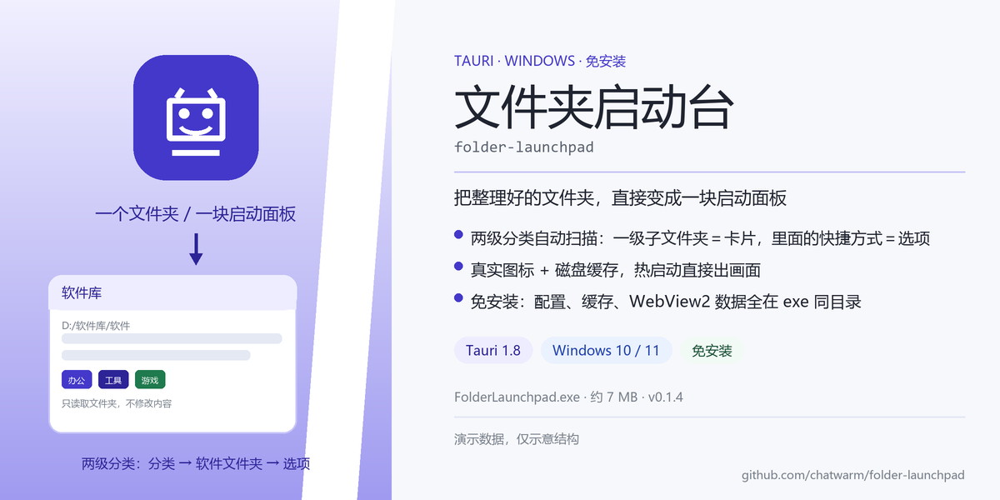
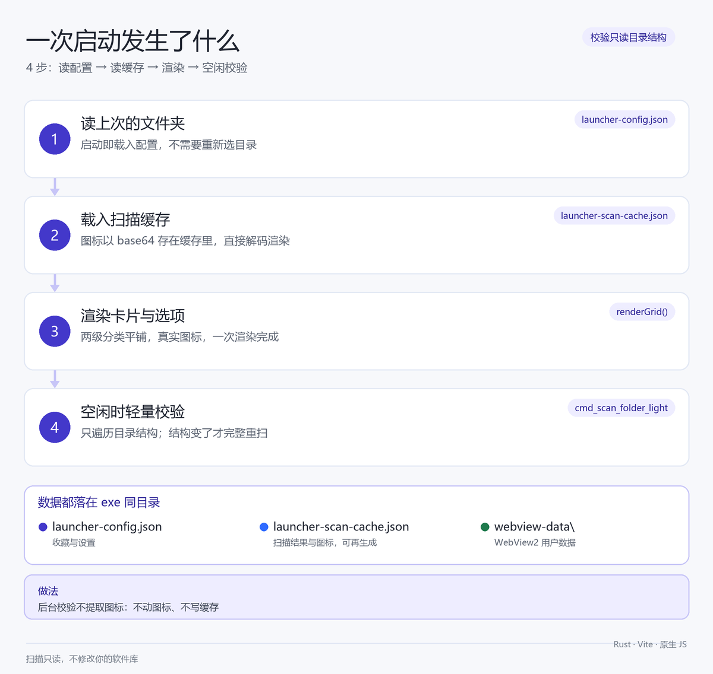

   

---

## 1. 它是什么

给「已经把软件按自己的习惯整理成文件夹」的人用的 Windows 启动面板：选定一个目录，它把目录结构直接画成卡片墙，点一下就启动。

它不建自己的数据库，也不要求你在程序里再整理一遍 —— **文件夹就是数据源**。你在资源管理器里增删、改名、移动，它扫描后照做。

> 分类文件夹需要你自己规划整理；本程序只负责把已有结构可视化并启动。

- **两级结构**：一级子文件夹＝一张卡片，卡片里的快捷方式＝选项；散落在外的条目单独平铺。
- **真实图标**：走 Windows Shell（`SHGetFileInfoW` + GDI）提取原生图标，48×48 PNG 内嵌显示。
- **单个约 5 MB 的 exe**：免安装，配置、缓存、WebView2 数据全部留在 exe 同目录，不写系统盘。
- **只读你的库**：扫描与渲染不修改被扫描目录里的任何文件。
- **只收录可启动的类型**：识别 exe / lnk / bat / cmd / com / msc 与 url / website；.ps1 / .py 双击是打开编辑器、.msi 是安装，不会被收录。

**技术栈**

| 层 | 选型 |
| --- | --- |
| 前端 | 原生 JS + Vite（无框架，零运行时依赖） |
| 后端 | Tauri 1.x（Rust）—— 目录扫描、图标提取、进程启动、Shell 集成 |
| 产物 | 单个 `.exe`（约 5 MB），前端资源由 `custom-protocol` 内嵌 |

## 2. 工作原理



1. **读配置**：启动即载入上次选择的文件夹与收藏，不需要重新选目录。
2. **读缓存**：`launcher-scan-cache.json` 里存着扫描结果与图标（base64），直接解码渲染。
3. **渲染**：一次性生成卡片与选项，不在渲染后做二次整页重绘。
4. **空闲校验**：`requestIdleCallback` 里跑一次**只遍历目录结构**的轻量扫描；结构真的变了才做完整扫描（含图标提取）。

| 产物（均在 exe 同目录） | 说明 |
| --- | --- |
| `launcher-config.json` | 文件夹路径、收藏、主题、点击方式、自动加载 |
| `launcher-scan-cache.json` | 扫描结果与图标，删除后自动重建 |
| `webview-data\` | WebView2 用户数据目录，可整目录删除 |

## 3. 快速开始

### 3.1 直接使用

1. 到 [Releases](https://github.com/chatwarm/folder-launchpad/releases) 下载最新的 `FolderLaunchpad-vX.Y.Z.zip`。
2. 解压到一个固定目录（建议非系统盘）。
3. 双击 `FolderLaunchpad.exe`，首次运行点左下角「选择文件夹」，选中你整理好的软件目录；之后每次打开会自动加载（可在设置中关闭）。

### 3.2 升级

只替换 `.exe`，**保留同目录的 `launcher-config.json`**（收藏与设置都在里面）。扫描缓存可删，程序会自动重建。

## 4. 从源码构建与调试

### 4.1 环境准备（仅首次）

| 依赖 | 要求 | 获取方式 |
| --- | --- | --- |
| Node.js | ≥ 18 | https://nodejs.org/ |
| Rust | 稳定版工具链 | https://rustup.rs/ ，运行 `rustup-init.exe` 后**重启终端** |
| C++ 构建工具 | MSVC 链接器 | https://visualstudio.microsoft.com/visual-cpp-build-tools/ ，勾选「使用 C++ 的桌面开发」 |
| WebView2 | Windows 10/11 一般已内置 | https://developer.microsoft.com/microsoft-edge/webview2/ |

验证：

```bash
node --version   # 期望 >= 18
cargo --version  # 期望 >= 1.70
rustc --version
```

### 4.2 一键构建

```bash
npm install          # 首次
npm run tauri build
```

`tauri build` 会先按 `tauri.conf.json` 的 `beforeBuildCommand` 自动执行 `npm run build`，无需手动前置构建前端。

产物：`src-tauri/target/release/launcher.exe`（重命名为 `FolderLaunchpad.exe` 即可分发）。

> `npm run tauri build` 已自动启用 `custom-protocol`；只有手动调用 cargo 时才需显式指定，否则前端资源不会内嵌，运行时会报「拒绝连接」：
> `cargo build --release --features custom-protocol`。

### 4.3 开发调试

```bash
npm install
npm run tauri dev
```

会启动一个带后端联动的开发窗口，前端代码热更新。

### 4.4 浏览器预览（无需后端环境）

前端界面是独立的，可直接在浏览器里看完整 UI（此时使用演示数据，点击只提示、不会真正启动程序）：

```bash
npm install
npm run dev
# 浏览器打开 http://localhost:5173
```

## 5. 功能与操作

| 场景 | 操作 |
| --- | --- |
| 启动软件 | 点卡片内的选项；单击 / 双击可在设置里对「正常选项」与「灰色弱化选项」分别配置 |
| 搜索 | 顶栏搜索框，匹配**卡片标题**与**选项名**（不区分大小写） |
| 收藏 | 选项或卡片右键 → 收藏；左侧「收藏」页按来源卡片归并 |
| 切换分类 | 左侧栏；可折叠为 64 px 图标栏 |
| 回到顶部 | 顶栏刷新按钮左侧的 ⬆ 按钮 |
| 主题 | 设置页切换亮色 / 暗色，重启保持 |
| 干扰项 | 卸载 / 帮助 / 官网等次要入口会弱化显示（变淡 + 排序靠后），不会被隐藏，仍可点击 |

**右键菜单**

| 对象 | 菜单项 |
| --- | --- |
| 卡片 / 选项 | 打开、收藏、在资源管理器中打开、打开文件位置、打开原文件位置、属性、复制路径 |
| 空白处（仅主内容区与左侧具体分类） | 刷新、在资源管理器中打开、打开所在位置、打开总目录路径 |

> 「打开文件位置」＝在资源管理器中打开所在文件夹并**选中**该项，快捷方式定位其本身；
> 「打开原文件位置」＝解析快捷方式，跳到它指向的程序。

**收藏页规则**：同一张卡片只收藏了一项时，点整张卡片即可启动；收藏多项时，点各自选项分别启动。

**设置页**：主题、启动点击方式（正常 / 灰色选项分别设置）、自动加载开关、清理缓存、数据位置说明。

## 6. 配置与数据目录

| 文件 / 目录 | 默认位置 | 作用 |
| --- | --- | --- |
| `launcher-config.json` | exe 同目录 | 文件夹路径、收藏、主题、点击方式、自动加载 |
| `launcher-config.json.bak` | exe 同目录 | 仅在配置解析失败时生成，保留损坏内容供排查，可直接删除 |
| `launcher-scan-cache.json` | exe 同目录 | 扫描结果与图标缓存 |
| `webview-data\` | exe 同目录 | WebView2 用户数据 |
| `scan-debug.log` | exe 同目录 | 仅在扫描异常缓慢、图标提取失败或配置解析失败时生成，用于排查 |

迁移：把整个程序文件夹拷走即可，收藏与设置一并带走。

## 7. 项目结构

```text
folder-launchpad/
├── index.html            # 入口页面（含 UI 结构）
├── package.json          # 前端依赖与脚本
├── vite.config.js        # Vite 配置
├── README.md             # 项目说明
├── LICENSE               # MIT 许可证
├── assets/readme/        # README 首图与流程图
├── src/
│   ├── main.js           # 前端核心逻辑（扫描/分类/渲染/启动桥接/菜单/设置）
│   └── style.css         # 界面样式（亮色/暗色主题）
└── src-tauri/
    ├── Cargo.toml        # Rust 依赖
    ├── tauri.conf.json   # 窗口与打包配置
    ├── build.rs
    ├── icons/            # 应用图标
    └── src/
        ├── main.rs       # 程序入口
        ├── lib.rs        # 核心命令：扫描/分类/启动/配置/Shell 集成
        └── icon.rs       # 图标提取（SHGetFileInfoW + GDI → PNG）
```

## 8. 常见问题

**Q：点快捷方式没反应？**
确认目标路径仍然有效；`.lnk` 交给系统解析，若它指向的程序已被卸载，需要重新创建快捷方式。

**Q：配置和收藏在哪？换电脑怎么办？**
都在 exe 同目录。把整个文件夹拷走即可迁移，收藏与设置一并带走。

**Q：为什么某个图标是旧的？**
图标缓存在目录结构未变化时不会自动更新，点顶栏「刷新」重建即可。

**Q：支持开机自启或托盘吗？**
当前版本不含托盘驻留。若需要开机自动出现，把本程序快捷方式放进 `shell:startup` 目录。

**Q：首次运行提示「已保护你的电脑」？**
未签名的个人构建，SmartScreen 会拦一次；点「更多信息 → 仍要运行」。

**Q：想改应用图标？**
替换 `src-tauri/icons/` 下的图标，或提供一张 1024×1024 的 PNG 源图，运行 `npm run tauri icon <源图路径>` 自动生成全套。

## 9. 开源协议（License）

本项目基于 [MIT License](./LICENSE) 开源。
